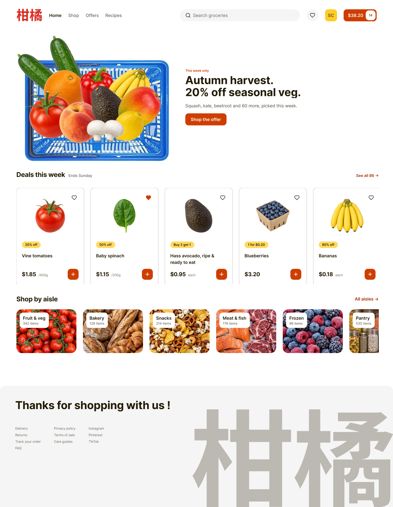
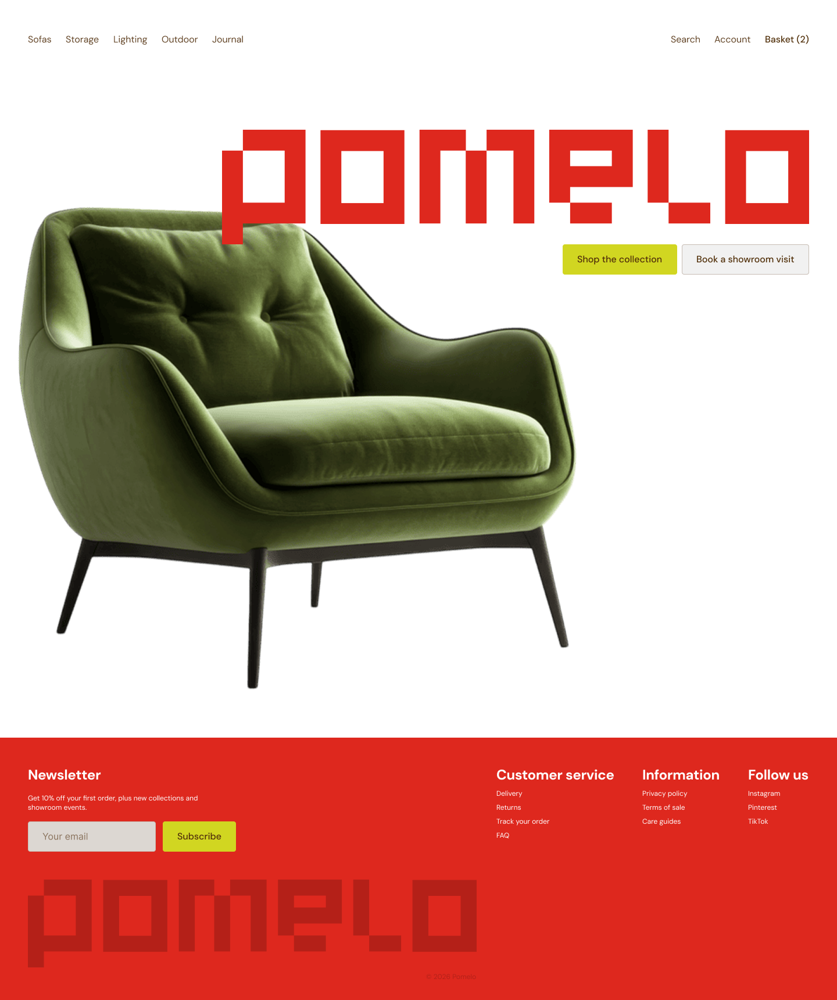
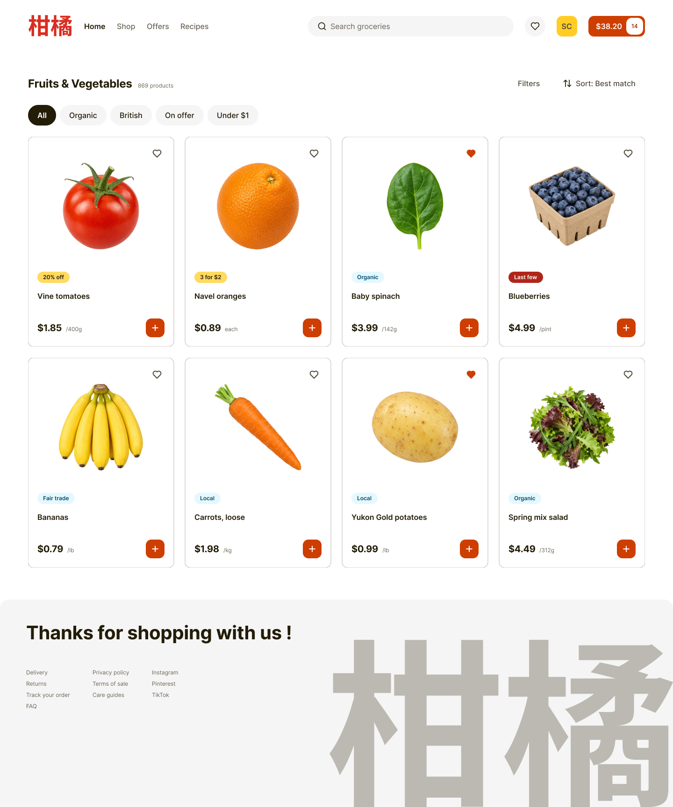
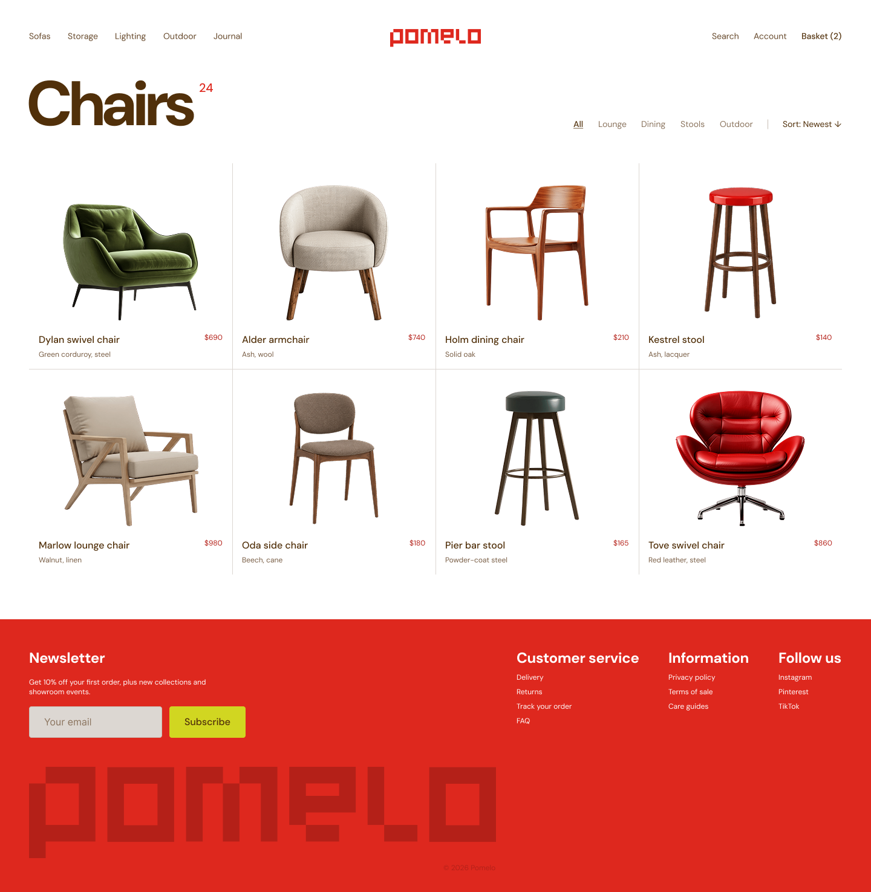
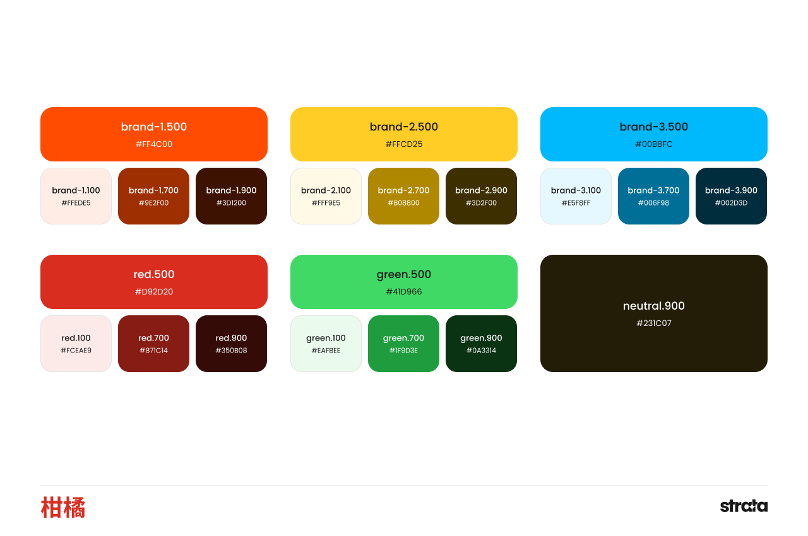
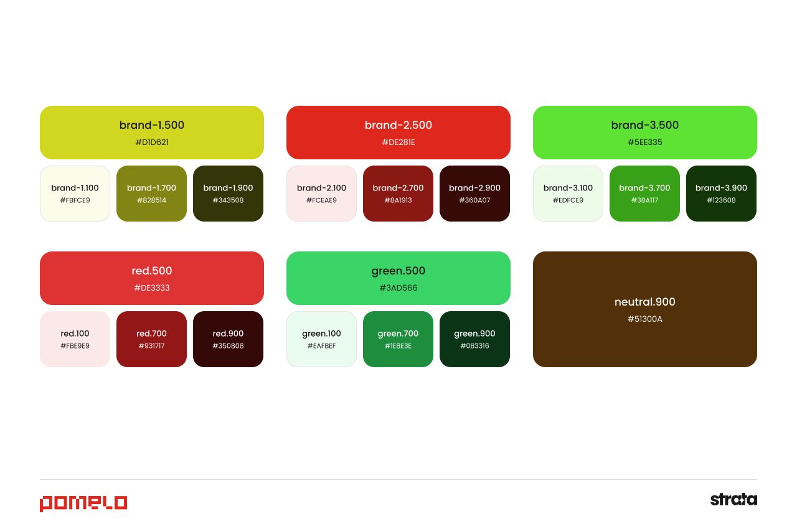

<h1>
  <picture>
    <source media="(prefers-color-scheme: dark)" srcset="docs/images/strata-logo-white.svg">
    
  </picture>
</h1>

strata is a headless design system that styles one set of unstyled components into any number
of brands, using design tokens authored in Figma. Each brand's pages and styling are published
as data, so changes go live without a redeploy, and every change is checked before it's allowed
to ship.

It's demonstrated with two fictitious brands: clementine, a grocery shop, and pomelo, a
furniture shop. Each has a home, shop, product and basket screen, all built from the same
components.

<p align="center">
  
  
</p>

<p align="center">
  
  
</p>

When a company runs several brands, each one tends to get its own styled components. That means every design update has to be made several times, or else the brands drift apart. Not to mention, each brand's pages still need a developer to change and redeploy them.

strata tries to fix both by de-coupling component functionality and styling--the components are written once in the codebase and never know which brand they're in. Screens are data that can be edited and published without touching the frontend. 

## Design System Architecture

### Two-Tiered Token System

Both in Figma and in the code, strata uses two tiers of tokens. Primitive tokens are raw values and Semantic tokens describe what a value is for, and point to a primitive.

Then, components only ever read semantic tokens, so the same button works on any brand with defined semantic tokens.

Hence, every brand has to define the 67 core semantic tokens that the shared components read. Beyond that, a brand can add tokens for the sections it uses. 

For example, both brands define the same colour primitives, but with their own values:

<p align="center">
  
  
</p>

Token files use the
[W3C DTCG](https://tr.designtokens.org/format/) format, so tools like Tokens Studio and Style
Dictionary can read them too.

### Screens as data

Each screen is an ordered list of sections, each with a type and its props:

```json
{
  "schemaVersion": 1,
  "screen": "home",
  "sections": [
    { "id": "seasonal-promo", "type": "Intro", "props": { "title": "Autumn harvest.", "gap": "space.stack.gap" } }
  ]
}
```

The frontend fetches the published screen and renders each section with its React component. It
never decides what a screen contains. If it finds a section type it doesn't know, it skips it
and logs it, so an older frontend doesn't break on newer data.

Styling props only accept token names, never raw values, so a screen stays on-brand! For safety, the backend validates each publish against a contract, and a frontend test fails if a section is in the contract without a component (and vice versa).

Products for the brands live in a published catalogue rather than in the frontend. Screens refer to products by
id, so a product card, a product page and a basket line all read from the same record.

### Publishing

A brand's tokens, screens and catalogue are versioned and published together, so a screen is
always checked against the tokens it ships with.

Publishing is refused for an unknown section, an invalid prop, a missing token, a product that
doesn't exist, a link to a missing screen, or a duplicate section id.

Every publish is compared with the previous version, and each change is given a severity:

| Change | Severity |
| --- | --- |
| A screen, section or product is removed, a section's type changes, or a semantic token is removed | Major |
| A screen, section or product is added, or sections are reordered | Minor |
| A prop, value or piece of text changes | Patch |

Major changes need to be approved before they're published. A published version is never edited;
any change becomes a new version.

## Try it out!

You'll need Python, Node and Docker Desktop (for Postgres).

### Backend

```bash
cp .env.example .env          # set DJANGO_SECRET_KEY, or leave it blank for local use
docker compose up -d db
python -m venv .venv          # then activate it
pip install -r requirements.txt
cd backend
python manage.py migrate
python manage.py seed          # publishes the tokens, screens and catalogue as v1
python manage.py createsuperuser
python manage.py runserver
```

The admin is at <http://127.0.0.1:8000/admin/>, where tokens can be edited without touching the
repo.

After changing anything in `tokens/`, `layouts/` or `catalogue/`, run
`python manage.py seed --update` to publish it as a new version.

With DEBUG on and no key set, Django generates a temporary secret key each time it starts. With DEBUG off, it refuses to start without one.

### Frontend

```bash
cd frontend
npm install
npm run dev                    # http://127.0.0.1:3000
```

The frontend forwards `/artifacts/*` and `/api/*` to Django. If port 8000 is already taken, run
Django on another port and point the frontend at it:

```bash
python manage.py runserver 8001
NEXT_PUBLIC_ARTIFACT_STORE=http://127.0.0.1:8001 npm run dev
```


Once the backend and frontend are running:

| Page | What it is |
| --- | --- |
| [/compare](http://127.0.0.1:3000/compare) | Both brands side by side, rendered by the same code |
| [/brands/clementine](http://127.0.0.1:3000/brands/clementine) | clementine's screens, with a working cart |
| [/brands/pomelo](http://127.0.0.1:3000/brands/pomelo) | pomelo's screens, with a working cart |
| [/pipeline](http://127.0.0.1:3000/pipeline) | Edit any screen and see what publishing it would do |
| [/matrix](http://127.0.0.1:3000/matrix) | Every component on each brand, with a live token slider |